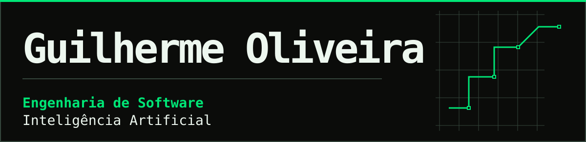
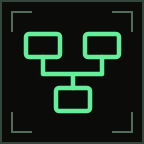
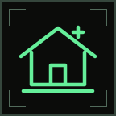

<h1>
  <picture>
    <source media="(max-width: 640px)" srcset="./assets/portfolio-b/cabecalho-mobile.svg">
    
  </picture>
</h1>

[Projetos](#projetos) · [Experiência](#experiência) · [Tecnologias](#tecnologias) · [Repositórios](https://github.com/yguioliveira?tab=repositories) · [E-mail](mailto:guioliveira.dev@outlook.com)

Curso **Engenharia de Software na PUC-Campinas** e sou **residente em Inteligência Artificial no Instituto Eldorado**. Trabalho com desenvolvimento de software, agentes, automações e integração de sistemas. Meus projetos vão de um painel de monitoramento a ferramentas de apoio à decisão.

## Projetos

### Conta Comigo

**Hack Brasil 2026** · Demo pública

Aplicação em equipe para ajudar MEIs a registrar receitas e despesas por texto, áudio ou foto e acompanhar o caixa.

- **Minha atuação.** Implementei a ingestão multimodal com Gemini e validação com Zod. Desenvolvi o chat que usa referências públicas e valores calculados pelo sistema, além do tratamento de falhas da IA.
- **Stack.** Next.js, TypeScript, Supabase, Gemini, Zod

[Repositório da equipe](https://github.com/ArthurSenna25/conta-comigo) · [Demo](https://conta-comigo-tau.vercel.app) · [PR de ingestão](https://github.com/ArthurSenna25/conta-comigo/pull/10) · [PR do chat](https://github.com/ArthurSenna25/conta-comigo/pull/26)

---

### AquaVita

**Challenge 2 · Residência em IA** · Em desenvolvimento

Apoia o cultivo de morangos com informação meteorológica e técnica. A equipe também desenvolve uma frente de triagem visual.

- **Minha atuação.** Desenvolvi o Agente de Cultivo, integrei dados meteorológicos e construí duas bases de conhecimento com busca por embeddings e similaridade cosseno.
- **Stack.** Python, Flask, LangChain, Gemini, Open-Meteo

[Repositório privado](https://github.com/yguioliveira/AquaVita)

---

### PI II · Gerenciamento de Demandas

**Projeto Integrador II · PUC-Campinas** · Implementação concluída

Sistema desenvolvido em equipe para organizar demandas de software vinculadas a projetos, da abertura ao acompanhamento.

- **Minha atuação.** Implementei a tela de login, a autenticação com bcrypt e o controle de acesso por projeto.
- **Stack.** Node.js, Express, TypeScript, Oracle

[Repositório privado](https://github.com/yguioliveira/PI-II-TIME-10)

---

### C1NC0 · Painel de Indícios

**Challenge 1 · Residência em IA** · MVP com demo pública

MVP desenvolvido em equipe para apoiar a leitura crítica de notícias com indícios como autoria, data e links citados.

- **Minha atuação.** Na minha versão, trabalhei na leitura guiada dos indícios, no checklist de verificação e na integração da interface React com a API Python.
- **Stack.** React, TypeScript, Vite, FastAPI, scikit-learn

[Demo da minha versão](https://c1nc0.vercel.app) · [Repositório privado](https://github.com/yguioliveira/c1nc0)

---

### Ladpy · Simulador de Votação

**Projeto Integrador I · PUC-Campinas** · Concluído

Simulador de votação em terminal, desenvolvido em equipe, que cobre cadastro, operação da urna, auditoria e apuração.

- **Minha atuação.** Trabalhei na navegação, na abertura e no encerramento da votação e nos registros de auditoria. Também contribuí com o boletim de urna e o script SQL.
- **Stack.** Python, MySQL

[Repositório](https://github.com/yguioliveira/Ladpy-Sistema-Votacao)

---

### StayCraft · Template de Hospedagens

**Projeto web pessoal** · Template em avaliação

Proposta de template para apresentar acomodações e experiências de hospedagem.

- **Minha atuação.** No projeto original, desenvolvi páginas responsivas de acomodações, galerias com animações e a estrutura de metadados para SEO.
- **Stack.** Next.js, React, TypeScript, Tailwind CSS, Framer Motion

Repositório privado

## Experiência

### Residência em Inteligência Artificial

**Instituto Eldorado · PUC-Campinas**

Desenvolvo soluções em equipe para os desafios da residência, com trabalho em agentes, recuperação de informações e integração de modelos com APIs. AquaVita e C1NC0 são dois exemplos.

### Desenvolvimento de software

**Freelance · Monitoramento NOC**

Trabalhei em um painel para acompanhar alertas operacionais. Integrei fluxos de e-mail e Telegram com n8n e usei Node.js e MySQL para centralizar esses eventos.

## Tecnologias

**Linguagens**  
`Python` `JavaScript` `TypeScript` `SQL`

**Frontend**  
`React` `Next.js` `HTML` `CSS` `Tailwind CSS`

**Backend**  
`Node.js` `Express` `FastAPI` `Flask` `APIs REST`

**Inteligência artificial**  
`Gemini` `LangChain` `RAG` `Embeddings` `scikit-learn`

**Bancos de dados**  
`MySQL` `Oracle` `PostgreSQL / Supabase`

**Automações**  
`n8n` `Integrações de e-mail e Telegram`

**Infraestrutura e ferramentas**  
`Git` `GitHub` `Vercel`
