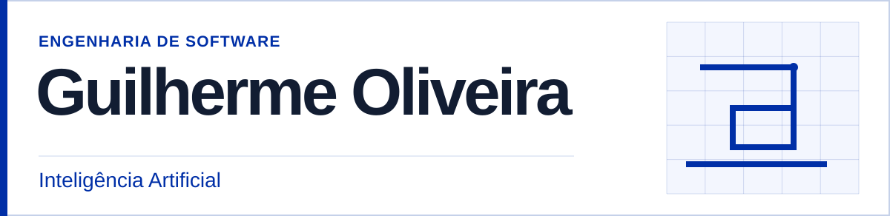

<h1>
  <picture>
    <source media="(max-width: 640px)" srcset="./assets/portfolio-a/cabecalho-mobile.svg">
    
  </picture>
</h1>

[Experiência](#experiência) · [Projetos](#projetos) · [Tecnologias](#tecnologias) · [Repositórios](https://github.com/yguioliveira?tab=repositories) · [E-mail](mailto:guioliveira.dev@outlook.com)

Curso **Engenharia de Software na PUC-Campinas** e sou **residente em Inteligência Artificial no Instituto Eldorado**. Trabalho com desenvolvimento de software, agentes, automações e integração de sistemas. Meus projetos vão de um painel de monitoramento a ferramentas de apoio à decisão.

## Experiência

**Residência em Inteligência Artificial** · Instituto Eldorado · PUC-Campinas

Desenvolvo soluções em equipe para os desafios da residência, com trabalho em agentes, recuperação de informações e integração de modelos com APIs. AquaVita e C1NC0 são dois exemplos.

**Desenvolvimento de software** · Freelance · Monitoramento NOC

Trabalhei em um painel para acompanhar alertas operacionais. Integrei fluxos de e-mail e Telegram com n8n e usei Node.js e MySQL para centralizar esses eventos.

## Projetos

<table width="100%">
  <tbody>
    <tr>
      <td>
        <strong>Conta Comigo</strong> 
        Hack Brasil 2026 · <em>Demo pública</em>  
        Aplicação em equipe para ajudar MEIs a registrar receitas e despesas por texto, áudio ou foto e acompanhar o caixa. 
        <strong>Minha atuação.</strong> Implementei a ingestão multimodal com Gemini e validação com Zod. Desenvolvi o chat que usa referências públicas e valores calculados pelo sistema, além do tratamento de falhas da IA.  
        <strong>Stack.</strong> Next.js, TypeScript, Supabase, Gemini, Zod 
        <a href="https://github.com/ArthurSenna25/conta-comigo">Repositório da equipe</a> · <a href="https://conta-comigo-tau.vercel.app">Demo</a> · <a href="https://github.com/ArthurSenna25/conta-comigo/pull/10">PR de ingestão</a> · <a href="https://github.com/ArthurSenna25/conta-comigo/pull/26">PR do chat</a>
      </td>
    </tr>
    <tr>
      <td>
        <strong>AquaVita</strong> 
        Challenge 2 · Residência em IA · <em>Em desenvolvimento</em>  
        Apoia o cultivo de morangos com informação meteorológica e técnica. A equipe também desenvolve uma frente de triagem visual. 
        <strong>Minha atuação.</strong> Desenvolvi o Agente de Cultivo, integrei dados meteorológicos e construí duas bases de conhecimento com busca por embeddings e similaridade cosseno.  
        <strong>Stack.</strong> Python, Flask, LangChain, Gemini, Open-Meteo 
        <a href="https://github.com/yguioliveira/AquaVita">Repositório privado</a>
      </td>
    </tr>
    <tr>
      <td>
        <strong>PI II · Gerenciamento de Demandas</strong> 
        Projeto Integrador II · PUC-Campinas · <em>Implementação concluída</em>  
        Sistema desenvolvido em equipe para organizar demandas de software vinculadas a projetos, da abertura ao acompanhamento. 
        <strong>Minha atuação.</strong> Implementei a tela de login, a autenticação com bcrypt e o controle de acesso por projeto.  
        <strong>Stack.</strong> Node.js, Express, TypeScript, Oracle 
        <a href="https://github.com/yguioliveira/PI-II-TIME-10">Repositório privado</a>
      </td>
    </tr>
    <tr>
      <td>
        <strong>C1NC0 · Painel de Indícios</strong> 
        Challenge 1 · Residência em IA · <em>MVP com demo pública</em>  
        MVP desenvolvido em equipe para apoiar a leitura crítica de notícias com indícios como autoria, data e links citados. 
        <strong>Minha atuação.</strong> Na minha versão, trabalhei na leitura guiada dos indícios, no checklist de verificação e na integração da interface React com a API Python.  
        <strong>Stack.</strong> React, TypeScript, Vite, FastAPI, scikit-learn 
        <a href="https://c1nc0.vercel.app">Demo da minha versão</a> · <a href="https://github.com/yguioliveira/c1nc0">Repositório privado</a>
      </td>
    </tr>
    <tr>
      <td>
        <strong>Ladpy · Simulador de Votação</strong> 
        Projeto Integrador I · PUC-Campinas · <em>Concluído</em>  
        Simulador de votação em terminal, desenvolvido em equipe, que cobre cadastro, operação da urna, auditoria e apuração. 
        <strong>Minha atuação.</strong> Trabalhei na navegação, na abertura e no encerramento da votação e nos registros de auditoria. Também contribuí com o boletim de urna e o script SQL.  
        <strong>Stack.</strong> Python, MySQL 
        <a href="https://github.com/yguioliveira/Ladpy-Sistema-Votacao">Repositório</a>
      </td>
    </tr>
    <tr>
      <td>
        <strong>StayCraft · Template de Hospedagens</strong> 
        Projeto web pessoal · <em>Template em avaliação</em>  
        Proposta de template para apresentar acomodações e experiências de hospedagem. 
        <strong>Minha atuação.</strong> No projeto original, desenvolvi páginas responsivas de acomodações, galerias com animações e a estrutura de metadados para SEO.  
        <strong>Stack.</strong> Next.js, React, TypeScript, Tailwind CSS, Framer Motion 
        Repositório privado
      </td>
    </tr>
  </tbody>
</table>

## Tecnologias

| Área | Ferramentas e práticas |
| --- | --- |
| Linguagens | Python · JavaScript · TypeScript · SQL |
| Frontend | React · Next.js · HTML · CSS · Tailwind CSS |
| Backend | Node.js · Express · FastAPI · Flask · APIs REST |
| Inteligência artificial | Gemini · LangChain · RAG · Embeddings · scikit-learn |
| Bancos de dados | MySQL · Oracle · PostgreSQL / Supabase |
| Automações | n8n · Integrações de e-mail e Telegram |
| Infraestrutura e ferramentas | Git · GitHub · Vercel |
