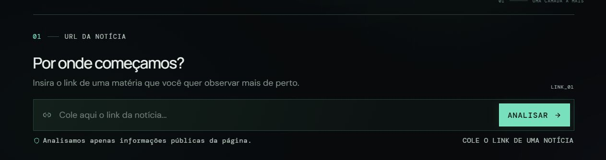

<h1>
  <picture>
    <source media="(max-width: 640px)" srcset="./assets/portfolio-b/cabecalho-mobile.svg">
    
  </picture>
</h1>

  <a href="https://github.com/yguioliveira">&nbsp;<strong>GitHub</strong></a>
  &nbsp;&nbsp;
  <a href="https://www.linkedin.com/in/guioliveira-dev">&nbsp;<strong>LinkedIn</strong></a>
  &nbsp;&nbsp;
  <a href="mailto:guioliveira.dev@outlook.com">&nbsp;<strong>E-mail</strong></a>

Curso **Engenharia de Software na PUC-Campinas** e sou **residente em Inteligência Artificial no Instituto Eldorado**. Trabalho com agentes, APIs e automações, integrando dados e serviços em sistemas web.

[Projetos ↓](#projetos-em-destaque) · [Competências ↓](#competências)

## Experiência

- **Instituto Eldorado · Residência em IA.** Desenvolvo agentes e integro modelos de linguagem e APIs em projetos de equipe, como AquaVita e C1NC0.
- **Freelance · Monitoramento NOC.** Trabalhei em um painel de alertas com Node.js e MySQL e integrei eventos de e-mail e Telegram usando n8n.

## Projetos em destaque

### Conta Comigo

**Hack Brasil 2026** · Demo pública

Aplicação em equipe para ajudar MEIs a registrar receitas e despesas por texto, áudio ou foto e acompanhar o caixa.

> **Minha contribuição.** Implementei a ingestão multimodal com Gemini e validação com Zod. Desenvolvi o chat que usa referências públicas e valores calculados pelo sistema, além do tratamento de falhas da IA.

**Tecnologias** · `Next.js` `TypeScript` `Supabase` `Gemini` `Zod`

[Repositório da equipe](https://github.com/ArthurSenna25/conta-comigo) · [Demo](https://conta-comigo-tau.vercel.app) · [PR de ingestão](https://github.com/ArthurSenna25/conta-comigo/pull/10) · [PR do chat](https://github.com/ArthurSenna25/conta-comigo/pull/26)

---

### AquaVita

**Challenge 2 · Residência em IA** · Em desenvolvimento

Apoia o cultivo de morangos com informação meteorológica e técnica. A equipe também desenvolve uma frente de triagem visual.

> **Minha contribuição.** Desenvolvi o Agente de Cultivo, integrei dados meteorológicos e construí duas bases de conhecimento com busca por embeddings e similaridade cosseno.

**Tecnologias** · `Python` `Flask` `LangChain` `Gemini` `Open-Meteo`

[Repositório privado](https://github.com/yguioliveira/AquaVita)

---

### PI II · Gerenciamento de Demandas

**Projeto Integrador II · PUC-Campinas** · Implementação concluída

Sistema desenvolvido em equipe para organizar demandas de software vinculadas a projetos, da abertura ao acompanhamento.

> **Minha contribuição.** Implementei a tela de login, a autenticação com bcrypt e o controle de acesso por projeto.

**Tecnologias** · `Node.js` `Express` `TypeScript` `Oracle`

[Repositório privado](https://github.com/yguioliveira/PI-II-TIME-10)

---

### C1NC0 · Painel de Indícios

**Challenge 1 · Residência em IA** · MVP com demo pública

MVP desenvolvido em equipe para apoiar a leitura crítica de notícias com indícios como autoria, data e links citados.

> **Minha contribuição.** Na minha versão, trabalhei na leitura guiada dos indícios, no checklist de verificação e na integração da interface React com a API Python.

**Tecnologias** · `React` `TypeScript` `Vite` `FastAPI` `scikit-learn`

[Demo da minha versão](https://c1nc0.vercel.app) · [Repositório privado](https://github.com/yguioliveira/c1nc0)

---

### Ladpy · Simulador de Votação

**Projeto Integrador I · PUC-Campinas** · Concluído

Simulador de votação em terminal, desenvolvido em equipe, que cobre cadastro, operação da urna, auditoria e apuração.

> **Minha contribuição.** Trabalhei na navegação, na abertura e no encerramento da votação e nos registros de auditoria. Também contribuí com o boletim de urna e o script SQL.

**Tecnologias** · `Python` `MySQL`

[Repositório](https://github.com/yguioliveira/Ladpy-Sistema-Votacao)

---

### StayCraft · Template de Hospedagens

**Projeto web pessoal** · Template em avaliação

Proposta de template para apresentar acomodações e experiências de hospedagem.

> **Minha contribuição.** No projeto original, desenvolvi páginas responsivas de acomodações, galerias com animações e a estrutura de metadados para SEO.

**Tecnologias** · `Next.js` `React` `TypeScript` `Tailwind CSS` `Framer Motion`

Repositório privado

## Competências

<strong>Linguagens</strong> 
&nbsp;Python &nbsp;·&nbsp; &nbsp;JavaScript &nbsp;·&nbsp; &nbsp;TypeScript &nbsp;·&nbsp; SQL

<strong>Frontend</strong> 
&nbsp;React &nbsp;·&nbsp; &nbsp;Next.js &nbsp;·&nbsp; &nbsp;Tailwind CSS &nbsp;·&nbsp; HTML e CSS

<strong>Backend</strong> 
&nbsp;Node.js &nbsp;·&nbsp; &nbsp;Express &nbsp;·&nbsp; &nbsp;FastAPI &nbsp;·&nbsp; &nbsp;Flask &nbsp;·&nbsp; APIs REST

<strong>Inteligência artificial</strong> 
&nbsp;Gemini &nbsp;·&nbsp; &nbsp;LangChain &nbsp;·&nbsp; &nbsp;scikit-learn &nbsp;·&nbsp; RAG e embeddings

<strong>Bancos de dados</strong> 
&nbsp;MySQL &nbsp;·&nbsp; &nbsp;PostgreSQL &nbsp;·&nbsp; &nbsp;Supabase &nbsp;·&nbsp; Oracle

<strong>Automações</strong> 
&nbsp;n8n &nbsp;·&nbsp; Integrações de e-mail e Telegram

<strong>Infraestrutura e ferramentas</strong> 
&nbsp;Git &nbsp;·&nbsp; &nbsp;GitHub &nbsp;·&nbsp; &nbsp;Vercel

Logotipos de tecnologias obtidos no <a href="https://simpleicons.org/">Simple Icons</a>.
